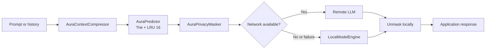

# AURA Engine Core

> On-device intelligence for low-latency, privacy-aware LLM routing.

## Executive Summary

AURA Engine Core is a Kotlin Multiplatform decision layer for applications that combine local models with cloud LLMs. It prepares a prompt locally, predicts intent, compresses context, masks sensitive data, selects a remote path when available, and falls back to a local engine when the network is unavailable or a provider fails.

The result is a smaller, safer request path with predictable degradation behavior. The core is designed for desktop, mobile, and edge experiences where latency, data locality, and API spend matter.

**Author:** Lead Engineer AURA Engine

**Status:** Day 2 DX and documentation baseline

## Why AURA

| Problem | AURA response |
| --- | --- |
| API cost | `AuraContextCompressor` removes redundant whitespace, filler words, and repeated punctuation before a request leaves the device. |
| Latency | `AuraPredictor` uses a prefix Trie and a 16-entry LRU cache for fast local intent prediction. |
| Privacy | `AuraPrivacyMasker` replaces email addresses, phone numbers, and 16-digit sensitive values before remote execution, then restores tokens locally. |
| Outages | `AuraFallbackRouter` sends requests to a `LocalModelEngine` when the network is unavailable or a remote call fails. |

## Architecture

```text
User prompt / conversation history
			  |
			  v
	 +----------------------+
	 | AuraContextCompressor |  reduce redundant context
	 +----------+-----------+
				|
				v
	 +----------------------+
	 |    AuraPredictor     |  Trie + 16-entry LRU
	 +----------+-----------+
				|
				v
	 +----------------------+
	 |  AuraPrivacyMasker   |  protect PII on device
	 +----------+-----------+
				|
				v
	 +----------------------+
	 |  AuraFallbackRouter  |  remote path or local fallback
	 +----------+-----------+
		  network? / \
			 yes   no or error
			  |       |
			  v       v
		Cloud LLM   LocalModelEngine
			  \       /
			   v     v
		unmask response locally
```

The same flow in Mermaid:



## Performance

`PerformanceBenchmarkTest` processes 100 representative prompts through `AuraContextCompressor` and `AuraPrivacyMasker`, measuring wall-clock time in milliseconds with `measureTimeMillis`. The test prints:

```text
AuraContextCompressor + AuraPrivacyMasker: <elapsed-ms> ms for 100 prompts
```

Observed baseline in the development container: `71 ms for 100 prompts` on JDK 17. The value is environment-dependent because CI hardware, JVM warm-up, and build cache state affect latency. Run it with:

```bash
./gradlew jvmTest --tests com.aura.core.PerformanceBenchmarkTest
```

This is a smoke measurement for the local preprocessing path, not a statistically rigorous production load test.

## Quick Start

Requirements: JDK 17 and the checked-in Gradle Wrapper.

```bash
git clone <repository-url>
cd aura-core
./gradlew test
./gradlew jvmTest
```

Use the core APIs from common code:

```kotlin
val compressor = AuraContextCompressor()
val masker = AuraPrivacyMasker()

val compressed = compressor.compress(prompt)
val masked = masker.mask(compressed.compressedText)
val safePrompt = masked.maskedText
val originalResponse = masker.unmask(modelResponse, masked.tokenMap)
```

## Technology Stack

- Kotlin Multiplatform with a shared `commonMain` core
- Compose Multiplatform for the desktop UI surface
- Gradle 8.10.2 via the Gradle Wrapper
- Kotlin 2.0.21 and Compose Multiplatform 1.7.1
- Kotlin Coroutines and Ktor for asynchronous networking

## Development Checks

```bash
./gradlew check
```

CI runs on every push and pull request targeting `main`, using Temurin JDK 17 and both `test` and `jvmTest` tasks.
